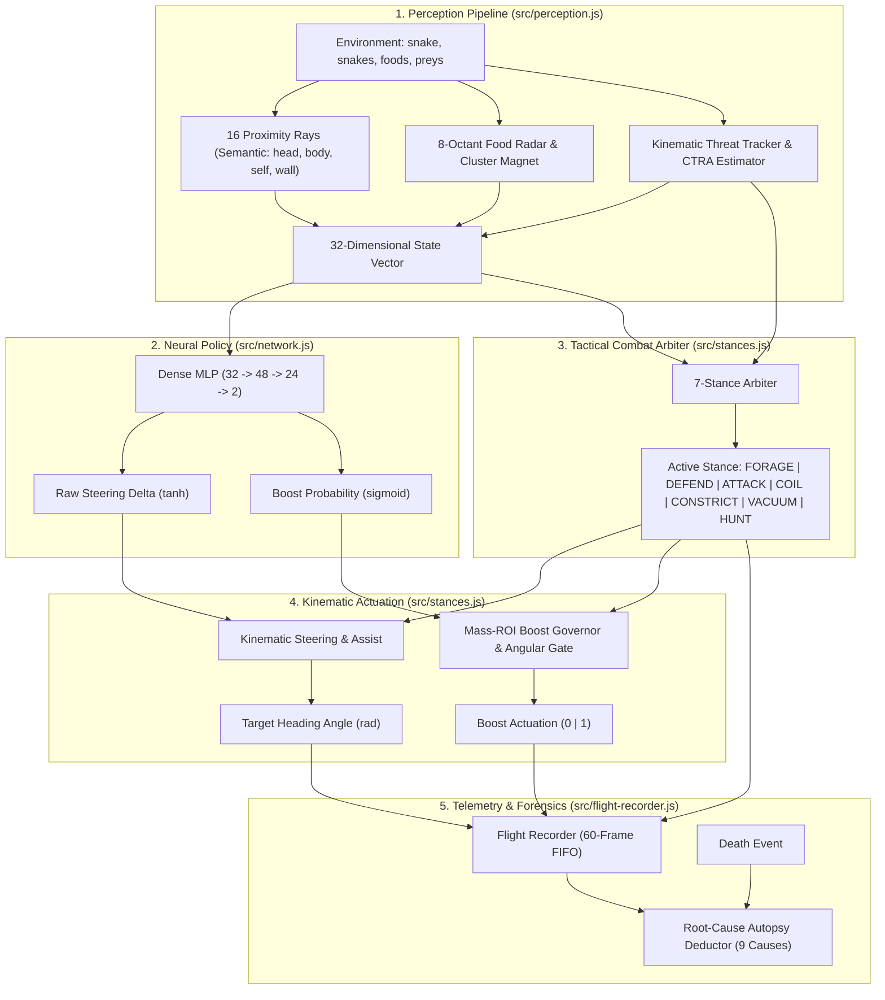
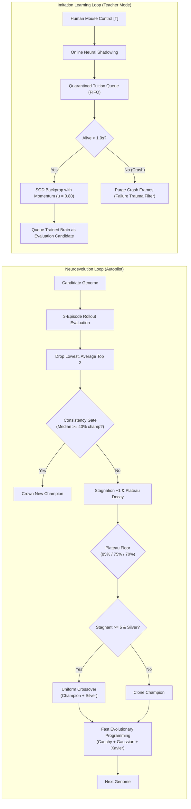

# SlitherML Architecture & System Design

This document details the architectural design, sensory pipeline, tactical state machine, neural policy, and dual learning algorithms powering SlitherML.

---

## 1. High-Level Data Flow

SlitherML executes at the browser display frame rate (~60 FPS) in Autopilot or Teacher Mode:

---

## 2. Sensory Perception Pipeline (32 Inputs)

The agent normalizes game data into a 32-element `Float32Array` on every evaluation frame:

| Input Index | Name | Description | Range |
| :---: | :--- | :--- | :---: |
| `0 .. 15` | **Proximity Rays** | 16 radial rays spanning 360° around the head (`ray[0]` = front, `ray[8]` = rear). Values represent normalized inverse distance to the nearest obstacle (1.0 = point-blank collision, 0.0 = clear to sensor range). Segments along enemy and own bodies are sampled with 300-segment density. | `[0.0, 1.0]` |
| `16 .. 23` | **Food Radar** | 8 spatial octants around the snake head. Normalizes food pellet mass and glowing prey density (`log(1 + foodMass) / scale`). | `[0.0, 1.0]` |
| `24` | **Wall Distance** | Normalized Euclidean distance from the arena center to the snake head divided by arena radius `grd`. | `[0.0, 1.0]` |
| `25` | **Wall Angle Pressure** | Signed angular deviation toward the arena center, scaled by wall pressure when `normWallDist > 0.55`. | `[-1.0, 1.0]` |
| `26` | **Self Scale** | Normalized body scale `min(1.0, scale / 8.0)`. | `[0.0, 1.0]` |
| `27` | **Boost Status** | Binary flag indicating whether the snake is currently sprinting (`speed > 7.0`). | `{0.0, 1.0}` |
| `28` | **Steering Inertia** | Exponential moving average (EMA) of prior turn deltas (`prevTurnEma`). | `[-1.0, 1.0]` |
| `29` | **Left Threat EMA** | Smoothed peak obstacle pressure across rays 9 through 15 (left flank). | `[0.0, 1.0]` |
| `30` | **Right Threat EMA** | Smoothed peak obstacle pressure across rays 1 through 7 (right flank). | `[0.0, 1.0]` |
| `31` | **Traffic Density** | Nearby enemy count normalized against maximum cluster threshold `min(1.0, count / 6)`. | `[0.0, 1.0]` |

### Semantic Ray Classification
Each ray hit is classified by object type:
- `'head'`: Active kinetic enemy head. Escalates evasion urgency by +35%.
- `'self'`: Own body coil. Collisions produce zero damage in Slither.io; danger urgency is dampened by 75% to prevent false evasions and enable coiling.
- `'body'`: Enemy flank or passive body segment.
- `'wall'`: Outer boundary of the circular arena. Triggers hard inward turn and boost cutoff.

---

## 3. Neural Architecture & Activation Functions

- **Layer Structure**: Dense Multi-Layer Perceptron (32 → 48 → 24 → 2).
  - Total trainable parameters: `(32×48 + 48) + (48×24 + 24) + (24×2 + 2) = 1,584 + 1,176 + 50 = 2,810` parameters (2,736 weights + 74 biases).
- **Hidden Activations**: Hyperbolic tangent (`tanh`) across hidden layers:
  $$f(x) = \tanh(x)$$
- **Output 0 (Steering Delta)**: Hyperbolic tangent (`tanh`):
  $$\Delta \theta = \tanh(z_0) \in [-1.0, 1.0]$$
  Mapped to heading update $\theta_{\text{target}} = \theta_{\text{current}} + 1.85 \cdot \text{EMA}(\Delta \theta)$.
  The output bias $b_{2,0}$ is dynamically centered and clamped within $[-0.15, 0.15]$ to prevent persistent one-directional circling.
- **Output 1 (Boost Activation)**: Standard logistic sigmoid:
  $$\sigma(z_1) = \frac{1}{1 + e^{-z_1}} \in [0.0, 1.0]$$

---

## 4. Tactical Combat Arbiter (7 Stances)

The combat arbiter in `src/stances.js` selects an operational stance based on state geometry:

1. **`COIL`**: Triggered when score ≥ 80, surrounded by threats (`inputs[31] >= 0.33`), and no open escape corridor exists (`maxCorridorDist <= headRadius * 3.5`). The snake loops in an inward circular orbit inside its own body shield until threats disperse.
2. **`DEFEND`**: Triggered when facing imminent collision (`dangerUrgency > 0.08`), an enemy cut-off attempt (`cutOffThreat`), or boundary wall proximity (`normWallDist > 0.91`). Evasion uses an asymmetric latch timer to prevent high-frequency left-right chatter.
3. **`ATTACK`**: Selected when a smaller target's vulnerable neck is within interception range, score ≥ 80, and the enemy is not a behemoth (`massRatio <= 1.5`). Uses Constant Turn Rate and Acceleration (CTRA) trajectory lead projection.
4. **`CONSTRICT`**: Activated when travelling alongside a smaller target (`ρ <= 0.65`) with flank bearing. Commands a tight orbit around the target while checking for outer third-party predators.
5. **`VACUUM`**: Triggered after a confirmed kill (6.5s latch) or when detecting a rich corpse cluster (`clusterCount >= 3` within 850u). Prioritizes corpse loot with rival scavenger offset.
6. **`HUNT`**: Pursues smaller targets in open space when danger urgency is low (`dangerUrgency < 0.25`).
7. **`FORAGE`**: Default stance when no combat threats are detected. Directs the snake toward ambient and glowing food pellets; executes exploratory sweeps (±14° at 0.6 Hz) when the field of view is empty.

---

## 5. Dual Learning Pipelines

### Neuroevolution Mechanics
- **Rollout Scoring**: Candidate genomes run over 3 episodes to filter out random spawn luck.
- **Consistency Gate**: A single heroic run cannot crown a champion if the candidate's median run is below 40% of the active champion fitness.
- **Adaptive Plateau Floor**: When evolution stagnates, the fitness requirement decays by 0.5% (gens 6–14) or 1.0% (gens 15+). To avoid unbounded decay, it is bounded by an all-time peak floor:
  - 85% of peak for `stagnantGens < 50`
  - 75% of peak for `50 <= stagnantGens < 60`
  - 70% of peak for `stagnantGens >= 60`
- **Fast Evolutionary Programming (FEP)**:
  - 85% Gaussian micro-mutations: $N(0, \sigma^2)$
  - 15% Cauchy heavy-tailed Lévy perturbations: $C(0, \gamma) = \tan(\pi(U - 0.5))$
  - Perturbation scaling: $\sigma_l = \sigma_0 \cdot \sqrt{\frac{24}{n_{\text{in}}}}$

### Imitation Learning Mechanics
- **SGD with Momentum**: Weight updates use momentum $\mu = 0.80$:
  $$v_{t+1} = \mu \cdot v_t + \eta \cdot \nabla_W L$$
  $$W_{t+1} = W_t - v_{t+1}$$
- **Binary Cross-Entropy Loss for Sprint**:
  $$L_{\text{BCE}} = -[y \ln(\hat{y}) + (1 - y) \ln(1 - \hat{y})]$$
  $$\frac{\partial L}{\partial z} = \hat{y} - y$$
- **Failure-Trauma Filter**: Crash frames (terminal 0.5–1.0s before death) are purged from the FIFO queue to prevent memorizing human panic mistakes.

---

## 6. Flight Recorder & Forensic Autopsy

`FlightRecorder` maintains a rolling 60-frame buffer of vehicle state. Upon death, `deduceDeathAutopsy()` evaluates pre-crash trajectory, obstacle types, velocities, and clearances to classify one of 9 root causes:

1. `ARENA_WALL`: Boundary impact (`normWallDist > 0.94`).
2. `ENCIRCLED_TRAP`: Entrapment during `COIL` without an exit corridor.
3. `HEAD_ON_RAM`: Head-to-head collision against an enemy with higher mass ratio.
4. `HEAD_ON_JOUST`: Head-to-head collision between similarly-sized snakes.
5. `ATTACK_OVEREXTENDED`: Collision during `ATTACK` stance where the cut-off failed.
6. `FLANK_CUTOFF`: High-velocity cut-off across enemy body segments.
7. `BODY_COLLISION`: Flank collision during cruising or foraging.
8. `BOOST_STARVATION`: Collision resulting from speed exhaustion at low mass.
9. `SUDDEN_IMPACT`: High-speed unexpected collision with an off-screen entity.

Telemetry summaries, zone distributions, and pathfinder breadcrumbs are embedded directly into exported checkpoint JSON files.
